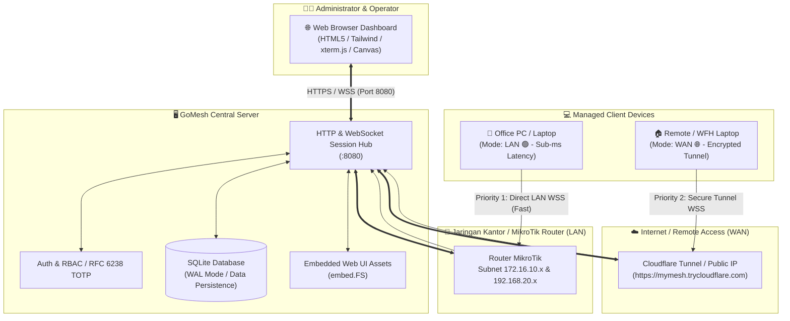
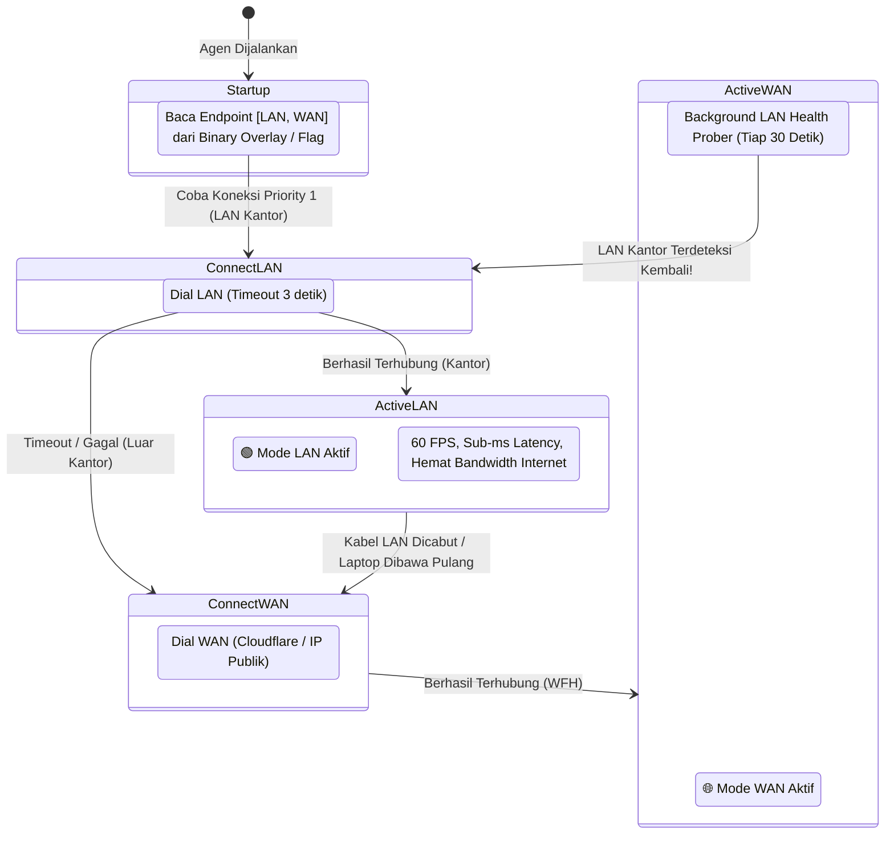
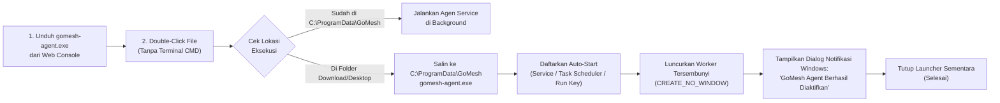

# GoMesh 🌐

> **High-Performance, Self-Hosted Remote Device Management & Remote Desktop in Pure Go.**  
> *A modern, lightweight, single-binary alternative to MeshCentral, TeamViewer, and AnyDesk.*

[](https://golang.org)
[](https://github.com/didikari/gomesh)
[](LICENSE)
[](https://github.com/didikari/gomesh)
[](https://github.com/didikari/gomesh)

---

## 🌟 Overview

**GoMesh** adalah platform *remote computer management & monitoring* berbasis web yang cepat, aman, dan hemat sumber daya (< 15MB RAM). Dibangun sepenuhnya dengan bahasa Go (tanpa CGO/GCC) dan arsitektur *outbound reverse WebSocket*, GoMesh memungkinkan Anda mengelola ribuan komputer Windows, Linux, dan macOS di balik NAT, firewall kantor, maupun koneksi seluler tanpa perlu membuka port (*port forwarding*) pada sisi klien.

GoMesh dilengkapi dengan teknologi **Smart Roaming Dual-Network**, integrasi **MikroTik Multi-VLAN**, **Remote Desktop real-time**, **Interactive Web Terminal (PTY)**, **Remote File Explorer**, **Two-Factor Authentication (TOTP 2FA)**, dan **Zero-Click Windows Deployment** (cukup double-click `.exe` tanpa CMD).

---

## 🚀 Fitur Unggulan (Key Features)

- **⚡ Interactive Web Terminal (xterm.js + PTY):**
  - Akses shell penuh (`powershell.exe` / `cmd.exe` di Windows, `/bin/bash` / `/bin/zsh` di Linux & macOS).
  - Emulasi terminal standar industri dengan ConPTY Windows & POSIX PTY. Mendukung warna ANSI penuh, resize window interaktif, dan shortcut keyboard (`Ctrl+C`, `Tab`).
- **🖥️ Live Remote Desktop & Input Control:**
  - Streaming layar real-time frame-by-frame dengan kompresi JPEG adaptif.
  - Kendali penuh mouse (klik kiri, kanan, tengah, drag, scroll) dan keyboard.
  - Mode *Interactive Control* atau *View-Only* serta tombol Fullscreen.
- **📂 Remote File Explorer:**
  - Penjelajahan direktori komputer target secara visual layaknya file manager lokal.
  - Chunked file upload dan download yang aman, pembuatan folder baru (*mkdir*), serta penghapusan file.
- **🌐 Smart Roaming Dual-Network (LAN Priority + Cloudflare Failover):**
  - **Prioritas 1 (LAN Kantor):** Terhubung langsung ke IP LAN lokal kantor/server untuk latensi sub-milidetik, hemat kuota internet, dan 60 FPS streaming.
  - **Prioritas 2 (WAN / Cloudflare Tunnel / IP Publik):** Saat perangkat dibawa pulang atau dinas ke luar kantor, agen otomatis melompat ke koneksi internet dalam 3 detik tanpa freeze.
  - **Background Prober Otomatis:** Saat aktif di luar kantor, agen secara berkala mengecek ketersediaan LAN kantor setiap 30 detik. Saat user kembali ke kantor, agen secara mulus kembali ke mode LAN kecepatan tinggi.
- **🔀 MikroTik Multi-VLAN & Multi-Subnet Aware:**
  - Tetap mendeteksi dan merutekan koneksi LAN lokal meskipun server dan klien berada di subnet/ether yang berbeda di bawah router MikroTik (misal: Server di `172.16.10.5` dan klien di `192.168.20.14`).
- **🖱️ Zero-Click Windows Deployment (Auto-Background Layer):**
  - File `.exe` yang diunduh dari Web Console sudah otomatis memuat konfigurasi server dan token (*baked-in configuration overlay*).
  - Klien cukup melakukan **double-click** pada file `.exe`. Program otomatis menyembunyikan jendela CMD, menyalin diri ke `C:\ProgramData\GoMesh`, mendaftarkan auto-start (Windows Service / Task Scheduler), berjalan di background layer (`CREATE_NO_WINDOW`), memunculkan dialog sukses, dan menutup launcher sementara.
- **🔐 Keamanan & Autentikasi Modern (RFC 6238 TOTP 2FA):**
  - Multi-user Role-Based Access Control (RBAC) dengan role `Admin` dan `Operator`.
  - Autentikasi Dua Faktor (2FA) bawaan standar Go murni tanpa dependensi eksternal, kompatibel dengan Google Authenticator, Authy, dan Microsoft Authenticator.
  - Audit logging lengkap untuk setiap sesi terminal dan desktop streaming.
  - Hash password terenkripsi bcrypt dan proteksi cookie sesi HTTP-only.
- **📦 Single Binary & Zero External Dependencies:**
  - Server dan agen berupa static binary mandiri.
  - Database embedded SQLite (WAL mode) tanpa memerlukan instalasi MySQL/PostgreSQL atau server terpisah.
  - Frontend Web UI di-bundle langsung ke dalam server executable via `embed.FS`.

---

## 🏛️ Arsitektur Sistem (System Architecture)



---

## 🔄 Alur Smart Roaming Dual-Network

Saat komputer klien (terutama laptop karyawan) berpindah lokasi antara kantor dan rumah, GoMesh secara otomatis beradaptasi tanpa perlu konfigurasi ulang:



---

## 🖱️ Alur Zero-Click Windows Self-Installation



---

## 🛠️ Instalasi & Kompilasi (Quick Start)

### 1. Kebutuhan Sistem
- **Server:** Linux, macOS, atau Windows.
- **Klien (Agent):** Windows 10/11/Server, Linux (Ubuntu, Debian, CentOS, Arch, dll.), macOS (Intel & Apple Silicon).
- **Kompilasi dari Source (Opsional):** Go 1.23+ (jika memakai binary pre-built, tidak memerlukan dependensi apapun).

---

### 2. Kompilasi dari Source

Clone repository dan build binary server serta agen:

```bash
# Clone repository
git clone https://github.com/didikari/gomesh.git
cd gomesh

# Build Central Server
go build -trimpath -ldflags="-s -w" -o bin/gomesh ./cmd/gomesh

# Build Agent untuk macOS (Host saat ini)
go build -trimpath -ldflags="-s -w" -o bin/gomesh-agent ./cmd/gomesh-agent

# Build Agent untuk Linux x86_64
GOOS=linux GOARCH=amd64 go build -trimpath -ldflags="-s -w" -o bin/gomesh-agent-linux ./cmd/gomesh-agent

# Build Agent untuk Windows (GUI subsystem - tanpa popup CMD)
GOOS=windows GOARCH=amd64 go build -trimpath -ldflags="-s -w -H=windowsgui" -o bin/gomesh-agent.exe ./cmd/gomesh-agent
```

> [!NOTE]
> Flag `-H=windowsgui` pada Windows memastikan agen berjalan sepenuhnya di layer latar belakang (*background layer*) tanpa memunculkan jendela console hitam.

---

### 3. Menjalankan GoMesh Central Server

Jalankan binary server:

```bash
./bin/gomesh -port 8080 -db data/gomesh.db
```

Output log akan muncul:
```text
2026/10/29 10:00:00 INFO starting GoMesh Central Server port=8080 db=data/gomesh.db
2026/10/29 10:00:00 INFO initialized default admin credentials username=admin initial_password=admin123
2026/10/29 10:00:00 INFO HTTP server listening address=0.0.0.0:8080
```

1. Buka browser Anda dan akses: `http://localhost:8080` (atau IP server Anda, misal: `http://192.168.1.5:8080`).
2. Login dengan akun bawaan:
   - **Username:** `admin`
   - **Password:** `admin123` *(Segera ganti password dan aktifkan TOTP 2FA di dashboard)*.

---

### 4. Menghubungkan Akses Luar Kantor (Cloudflare Tunnel - Gratis)

Jika server Anda berada di jaringan kantor tanpa IP publik statis, Anda dapat menggunakan Cloudflare Tunnel gratis untuk akses jarak jauh dari mana saja tanpa membuka port router:

```bash
# Pasang cloudflared (jika belum ada)
# Jalankan tunnel instan gratis ke server lokal GoMesh
cloudflared tunnel --url http://localhost:8080
```

Cloudflare akan memberikan URL publik seperti:  
`https://contoh-acak.trycloudflare.com`

---

## 💻 Cara Menghubungkan Komputer Klien (Agent)

GoMesh menyediakan 3 metode deployment yang sangat mudah:

### Metode 1: Zero-Click Download (Paling Disukai untuk Windows)
1. Buka dashboard GoMesh di browser.
2. Klik tombol **"+ Add Device"** di pojok kanan atas.
3. Di tab **Smart Roaming**, pilih IP LAN kantor Anda (misal `ws://192.168.1.5:8080/ws/agent`) dan masukkan URL Cloudflare WAN (misal `wss://contoh.trycloudflare.com/ws/agent`).
4. Klik tombol **"Unduh Agen Windows (.exe)"**.
5. Kirim file `.exe` ke komputer klien (via flashdisk, WhatsApp, atau jaringan).
6. Di komputer klien, cukup **Double-Click** file tersebut.
   - Program otomatis menginstal ke `C:\ProgramData\GoMesh`.
   - Otomatis mendaftarkan startup service (auto-start saat boot/login).
   - Berjalan langsung di latar belakang tanpa jendela CMD.
   - Status komputer langsung muncul **🟢 Online [LAN]** atau **🌐 Online [WAN]** di web dashboard!

---

### Metode 2: 1-Line Script Terminal (Linux & macOS)

Di modal **"+ Add Device"**, salin perintah 1-baris sesuai sistem operasi target:

#### Linux (Ubuntu / Debian / CentOS / RedHat):
```bash
curl -sSL "http://192.168.1.5:8080/api/download/installer/linux-sh?token=YOUR_TOKEN&endpoints=ws://192.168.1.5:8080/ws/agent,wss://contoh.trycloudflare.com/ws/agent&group=Production" | sudo bash
```
*Script ini otomatis mengunduh binary ke `/usr/local/bin/gomesh-agent` dan mendaftarkan service `systemd` dengan restart otomatis.*

#### macOS (Apple Silicon & Intel):
```bash
curl -sSL "http://192.168.1.5:8080/api/download/installer/macos-sh?token=YOUR_TOKEN&endpoints=ws://192.168.1.5:8080/ws/agent,wss://contoh.trycloudflare.com/ws/agent&group=Design" | sudo bash
```
*Script ini otomatis mengunduh binary ke `/usr/local/bin/gomesh-agent` dan mendaftarkan `LaunchDaemon` (`/Library/LaunchDaemons/com.gomesh.agent.plist`).*

---

### Metode 3: Eksekusi Manual / CLI Flag

Jika Anda ingin menjalankan agen secara interaktif untuk keperluan testing atau debugging:

```bash
# Menggunakan flag multi-endpoint Smart Roaming
./bin/gomesh-agent \
  -endpoints "ws://192.168.1.5:8080/ws/agent,wss://contoh.trycloudflare.com/ws/agent" \
  -token "YOUR_ENROLLMENT_TOKEN" \
  -group "Head Office" \
  -foreground
```

---

## 📖 Referensi Parameter CLI (CLI Flags)

### GoMesh Server (`gomesh`)
| Flag | Tipe | Default | Deskripsi |
| :--- | :--- | :--- | :--- |
| `-port` | `int` | `8080` | Port TCP untuk HTTP web server dan WebSocket hub |
| `-db` | `string` | `data/gomesh.db` | Lokasi file database embedded SQLite |

### GoMesh Agent (`gomesh-agent` / `gomesh-agent.exe`)
| Flag | Tipe | Default | Deskripsi |
| :--- | :--- | :--- | :--- |
| `-endpoints` | `string` | `""` | Daftar URL WebSocket server terurut berdasarkan prioritas (pisahkan dengan koma). Contoh: `"ws://192.168.1.5:8080/ws/agent,wss://mesh.domain.com/ws/agent"` |
| `-server` | `string` | `""` | URL tunggal WebSocket server (fallback jika `-endpoints` tidak diisi) |
| `-token` | `string` | `""` | Token enrollment pendaftaran perangkat baru |
| `-group` | `string` | `""` | Nama kelompok perangkat (misal: `Kantor Pusat`, `Server Lab`, `Cabang Surabaya`) |
| `-config` | `string` | `.` | Direktori penyimpanan hardware UUID dan identitas agen |
| `-foreground` | `bool` | `false` | Menjalankan agen di console interaktif tanpa auto-install ke background service |

---

## 🔒 Konfigurasi Keamanan & 2FA

### Mengaktifkan Two-Factor Authentication (TOTP):
1. Buka dashboard GoMesh dan klik profil admin di pojok kanan atas.
2. Pilih **"Enable 2FA"**.
3. Scan QR Code yang muncul menggunakan aplikasi authenticator di ponsel Anda (Google Authenticator, Microsoft Authenticator, atau Authy).
4. Masukkan kode 6 digit untuk verifikasi dan konfirmasi.
5. Setiap login berikutnya akan meminta kode OTP 6 digit yang berganti setiap 30 detik.

> [!TIP]
> GoMesh membangkitkan QR Code 2FA secara murni di dalam memory server (*pure Go offline PNG data URI*), sehingga rahasia autentikasi Anda tidak pernah dikirim ke layanan generator API pihak ketiga di internet.

---

## 📂 Struktur Direktori Proyek

```text
GoMesh/
├── cmd/
│   ├── gomesh/                    # Main entry point GoMesh Central Server
│   │   └── main.go                # HTTP handlers, WebSocket multiplexer, REST API
│   └── gomesh-agent/              # Main entry point Device Agent
│       ├── main.go                # Agent lifecycle & smart roaming prober
│       ├── selfinstall_windows.go # Zero-click self-installation untuk Windows
│       ├── selfinstall_other.go   # Stub self-installation untuk Linux/macOS
│       ├── service_windows.go     # Integrasi Windows Service Control Manager
│       └── service_other.go       # Stub service dispatcher non-Windows
├── internal/
│   ├── agent/                     # Logika klien agen
│   │   ├── client.go              # WebSocket dialer, failover loop, LAN prober
│   │   ├── embeddedcfg/           # Dynamic binary overlay reader & appender
│   │   ├── desktop/               # Capture layar JPEG & injeksi keyboard/mouse
│   │   ├── filemgr/               # Remote file explorer, upload/download chunks
│   │   ├── pty/                   # Spawner PTY/shell (ConPTY & POSIX PTY)
│   │   └── telemetry/             # Pengumpul info CPU, RAM, OS, hostname, IP
│   ├── protocol/                  # Definisi kontrak framing pesan WebSocket
│   │   └── messages.go
│   └── server/                    # Logika internal server
│       ├── auth/                  # RBAC, session cookie store, RFC 6238 TOTP
│       ├── hub/                   # WebSocket relay hub & subnet/router detector
│       └── store/                 # SQLite storage layer (WAL mode & schema)
├── web/                           # Embedded Web Management Console
│   ├── embed.go                   # Go embed.FS declaration
│   ├── index.html                 # Single-page UI (Tailwind CSS, xterm.js, Canvas)
│   └── static/
├── scripts/                       # Shell & PowerShell deployment scripts
│   ├── install-windows.ps1
│   ├── install-linux.sh
│   └── install-macos.sh
├── docs/                          # Dokumentasi teknis & Foundation Pack
│   ├── architecture/overview.md   # Cetak biru arsitektur
│   ├── product/prd.md             # Product Requirements Document
│   └── roadmap/implementation-plan.md # Roadmap implementasi & checklist
├── go.mod
├── go.sum
└── README.md
```

---

## 🛡️ Anti-Virus & EDR Compatibility

Banyak perangkat lunak remote management open-source sering terdeteksi sebagai false-positive oleh Windows Defender karena menggunakan packer (seperti UPX) atau teknik injeksi memori. GoMesh dirancang bersih:
- **Tanpa Packer:** Binary dikompilasi secara native murni tanpa UPX atau crypter pihak ketiga.
- **Standar Windows Service:** Menggunakan API resmi Windows Service Control Manager (`golang.org/x/sys/windows/svc`) dan Task Scheduler standar.
- **Reputasi Bersih:** Seluruh syscall input mouse dan keyboard menggunakan Win32 `SendInput` resmi.

---

## 🤝 Kontribusi

Kontribusi kode, laporan bug, dan usulan fitur sangat kami hargai!
1. Fork repository ini.
2. Buat branch fitur baru (`git checkout -b feature/fitur-keren`).
3. Commit perubahan Anda dengan pesan commit standar (`git commit -m "feat: add remote terminal sound bell"`).
4. Pastikan seluruh pengujian lolos (`go test ./...`).
5. Push ke branch Anda (`git push origin feature/fitur-keren`).
6. Buat Pull Request baru.

---

## 📄 Lisensi

GoMesh didistribusikan di bawah lisensi [MIT](LICENSE). Bebas digunakan, dimodifikasi, dan didistribusikan baik untuk keperluan personal maupun komersial.
